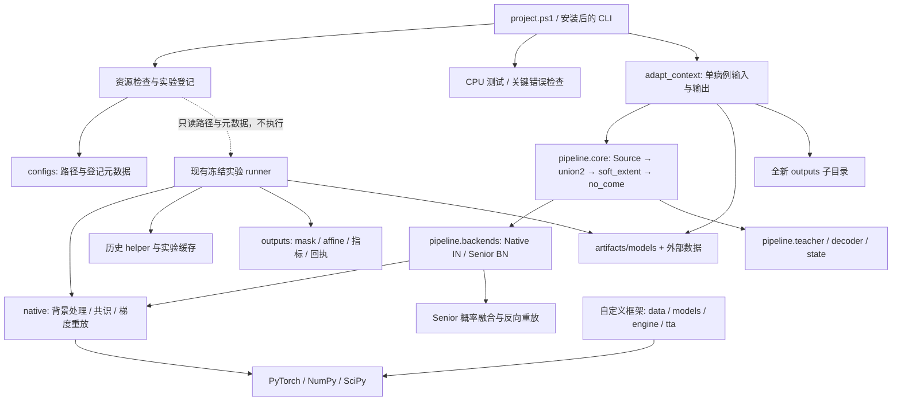

# 工程架构与依赖边界

本仓库采用已有 `src` 包布局。公共框架负责可维护代码，冻结实验负责说明历史成绩由什么实现产生，两者的对应关系必须明确记录。



登记模块 `brats_tta.experiments` 只读 YAML 并校验路径/状态字段，不动态 import runner。目录存在性只在 `show` 或 `check --local` 查询；不会加载 checkpoint、使用目标标签、初始化模型或恢复任务。

| 层 | 维护入口 | 关键边界 |
|---|---|---|
| 完整方法 | [pipeline](../../src/brats_tta/pipeline/README.md) | 统一单病例编排；明确区分 IN logit 融合与 Senior BN 概率融合；不导入日期实验 |
| 算法原语 | [native](../../src/brats_tta/native/README.md) | 背景变换、共识、IN 目标和梯度重放；本轮保持原文件字节不变 |
| 自定义训练/TTA框架 | [包说明](../../src/brats_tta/README.md) | 与 native nnU-Net 的训练/输入/指标协议分开 |
| 资源和运行导航 | [paths.py](../../src/brats_tta/paths.py)、[experiments.py](../../src/brats_tta/experiments.py) | 相对路径跟随 checkout；登记状态是快照，不是监控 |
| 用户命令 | [scripts/project.ps1](../../scripts/project.ps1)、`cli/` | 参数解析与调用，科学常数不复制到导航 |
| 检查 | [tests](../../tests/README.md)、[CI](../../.github/workflows/ci.yml) | 小型 CPU 验证；不代替完整分割实验 |

## 现存依赖为何保留

历史 IN runner 仍加载旧效率先导，历史 Senior runner 仍使用同目录快照。这些文件路径、代码哈希和结果身份互有关联，因此保留原样，供旧结果追溯。

新入口已经采用“CLI → pipeline → 算法模块”，由用户明确传入模型与四个 MRI 文件。`ORIGIN.json` 只记录来源，不在运行时读取旧源码。`tests/reference/tta_pipeline/` 是冻结测试参考，生产代码禁止导入。单例回归与数值边界见[重构记录](refactor-validation.md)。

## 文件布局

```text
3dunet/
├─ README.md / CONTRIBUTING.md / AGENTS.md / HANDOFF.md
├─ pyproject.toml / .editorconfig
├─ .github/                    CPU CI 及其依赖
├─ src/brats_tta/              公共源码、资源/实验登记及 CLI
├─ configs/                    路径、训练配置、实验登记
├─ scripts/                    统一本机入口与历史工具
├─ tests/                      公共代码测试
├─ docs/
│  ├─ guides/                  入门、开发、复现
│  ├─ reference/               工程架构
│  ├─ archive/                 历史记录
│  └─ 既有方法/索引/冻结报告
├─ outputs/                    冻结实验与运行产物
└─ artifacts/                  模型备份、旧 helper、维护记录
```

没有引入新的训练框架、配置框架、Conda 环境或自动巡检。完整目录职责与源码 Git 可见性见[文件说明](../PROJECT_FILE_GUIDE.md)。
